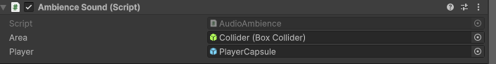

# Ambience: Collider
1. Create an empty Game Object and add a Box Collider
2. Set "Is Trigger" as TRUE
3. Create an empty Game Object and add an Audio Source
4. **IMPORTANT!!!**: Set the Spatial Blend as 3D
5. Add to the Audio Source the script [AudioAmbience.cs](AudioAmbience.cs)
6. Set the Collider and the player

