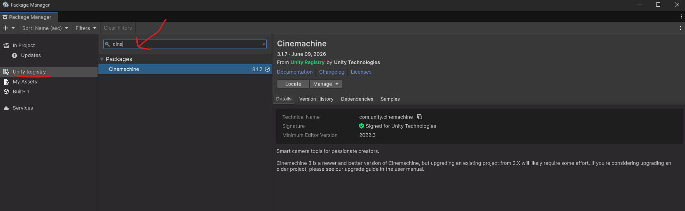
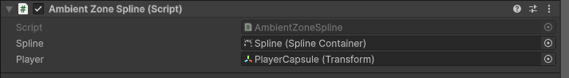

# Ambience: Spline
**IMPORTANT!!!**: Install the Cinemachine Asset Pack before. You can download it in `Windows > Package Management > Package Manager`.

1. Create a GameObject and call it "SplineContainer"
2. Add the Spline Container to the GameObject
3. Edit your spline. Here is an example

To edit manually the points, select the gameobject "SplineContainer" and toggle "Tool Contexts"

This will show you the Spline tool, which will allow you to edit the spline.

4. Create an empty Game Object and add an Audio Source
5. **IMPORTANT!!!**: Set the Spatial Blend as 3D
6. Add to the Audio Source the script [AmbientZoneSpline.cs](AmbientZoneSpline.cs)
7. Set the Spline and the player

