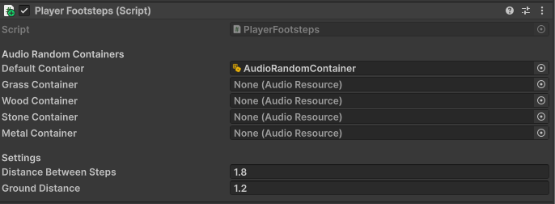

# How can I implement sound for the player's footsteps?
1. Create a Random Audio Container with at least 4 audios of steps
2. Add a range for the pitch and volume
3. Add to the player the script [PlayerFootsteps.cs](PlayerFootsteps.cs)

It will show you something like this:



This script will check the floor at a fixed time by throwing a ray to the floor to check what the player is stepping, and apply the sounds for the footsteps that you need.

## FAQS
### Steps sound too quickly or too slow...
Increase or decrese the Distance between steps. This variable fixes the time between one of the sounds and the next one
### What is the Ground Distance?
The distance between the transform of your GameObject and the floor. If your player is very tall, increase this value, or the floor will not be detected
### What are the other containers?
The other containers are for the sounds for other materials.

Example: If I want the steps to sound different when the player is stepping on grass, we would add a different audio container so if it detects the grass and apply the sound needed
### How can I tell my game that the player is on top of grass/wood/stone/metal?
Let's do an example with grass. Imagine we want to say which areas are grass.

4. You have two options here:
    - Select all the objects that are grass
    - ...or create an empty GameObject with a box collider, and adapt it to where the grass is and its scale
5. Add to what you have selected/created the script [FootstepSurface.cs](FootstepSurface.cs)
6. Choose with surface you want
7. Make sure that your player has an audio clip/random container for that surface
### Can I use other surfaces?
Yes! This are only examples, but you can always add more. 

In order to add them, you have to go to the code and add:
- In FootstepSurface.cs: Add your new surface to the SurfaceType:

```c#
public enum SurfaceType
{
    Default,
    Grass,
    Wood,
    Stone,
    Metal,
    Ice     // NEW SURFACE
}
```

- In PlayerFootsteps.cs:
```c#
[Header("Audio Random Containers")]
public AudioResource defaultContainer;
public AudioResource grassContainer;
public AudioResource woodContainer;
public AudioResource stoneContainer;
public AudioResource metalContainer;
public AudioResource iceContainer; // NEW SURFACE
```

```c#
switch (surfaceType)
        {
            case SurfaceType.Grass:
                container = grassContainer;
                break;
            case SurfaceType.Wood:
                container = woodContainer;
                break;
            case SurfaceType.Stone:
                container = stoneContainer;
                break;
            case SurfaceType.Metal:
                container = metalContainer;
                break;
            case SurfaceType.Ice: // NEW SURFACE
                container = iceContainer; // NEW SURFACE
                break;
        }
```