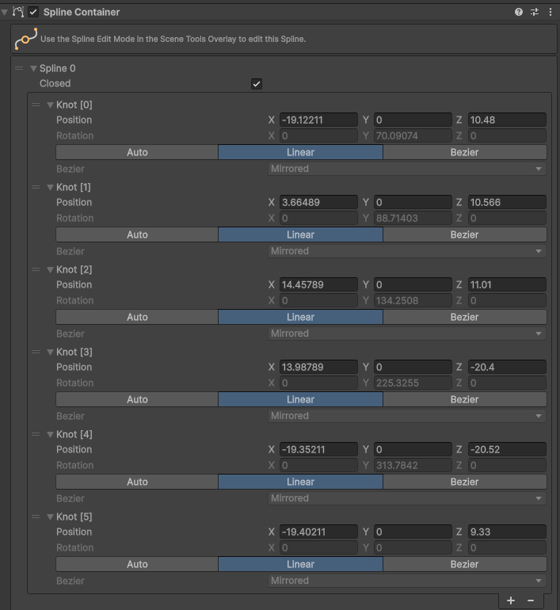
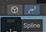
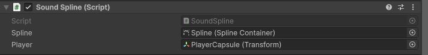

# How can I make a sound follow the player ONLY in certain areas?
You can use a Spline to trace the path of the sound, and connect it to the player.

How?

**IMPORTANT!!!**: Install the Cinemachine Asset Pack before. You can download it in `Windows > Package Management > Package Manager`.

1. Create a GameObject and call it "SplineContainer"
2. Add the Spline Container to the GameObject
3. Edit your spline. Here is an example

To edit manually the points, select the gameobject "SplineContainer" and toggle "Tool Contexts"

This will show you the Spline tool, which will allow you to edit the spline.

4. After that, create an Audio Source
5. **IMPORTANT!!!**: Set the Spatial Blend as 3D
6. Add the script [SoundSpline.cs](.\SoundSpline.cs) to your project
7. Add the Component "Sound Spline" to your **Audio Source**
7. Add the Spline and the Player to the component:

