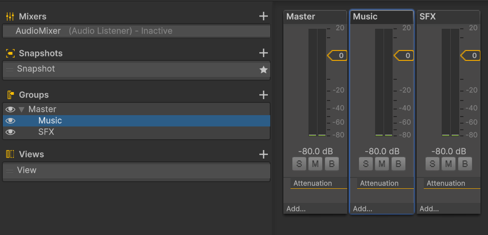
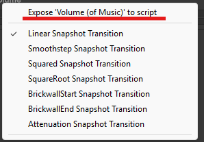
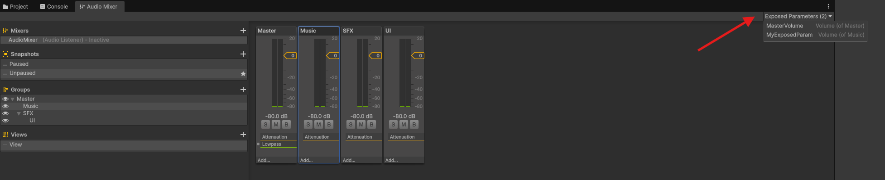

# How can I mute/unmute my audio?

1. Create an Audio Mixer called "Audio Mixer"
2. Click "Audio Mixer" and add two audio groups: "Music" and "SFX".

You should be able to see something like this without the audio groups:

3. Click the Master Audio Group and go to the inspector
4. Click with the right click on top of Volume. It will show you a menu like this. Click "Expose 'Volume (of Master)' to script" 

5. Volume will show you with an arrow:

6. Go to the window "Audio Mixer" and go to "Exposed Parameters"

7. Click 2 times and change the name of the parameter to something you can remember like "MasterVolume"
8. Do steps 3-7 for the other groups
9. Create a Game Object and add the script [AudioManager.cs](AudioManager.cs). If you already did it for other tutorials, there is no need to add it
10. Add the audio mixer

Now we have the parameter to be able to change the volume!

Usually we let the user be able to change Master (all), Music and SFx volume, but create groups as needed.

Once you do that, you can choose between creating a button to mute/unmute, or a volume slider. The following tutorials show how to implement both options. Each script saves the configuration for the volume.

- [How can I implement a Mute/Unmute button?](./button/mute_button.md)
- [How can I implement a volume slider](./slider/volume_slider.md)